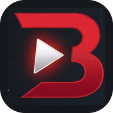
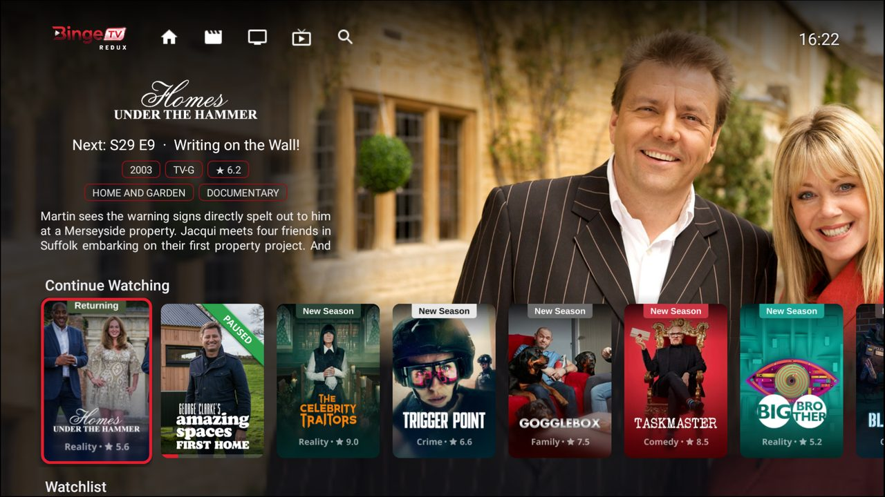
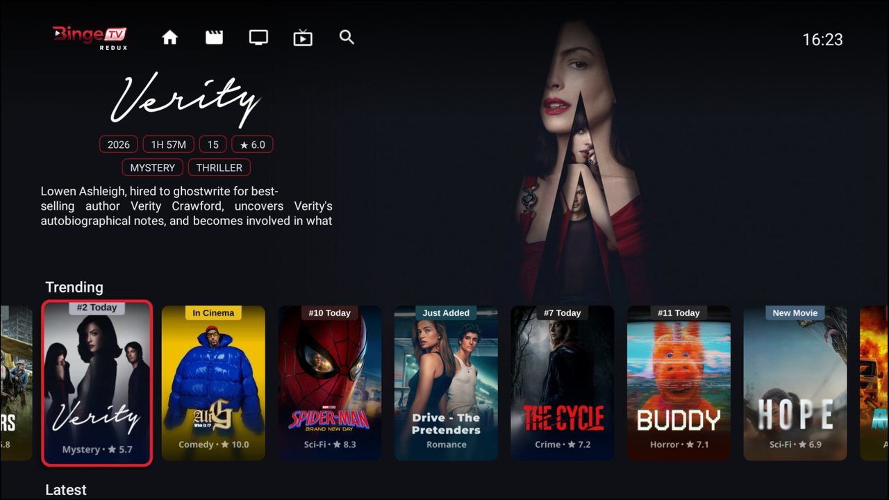
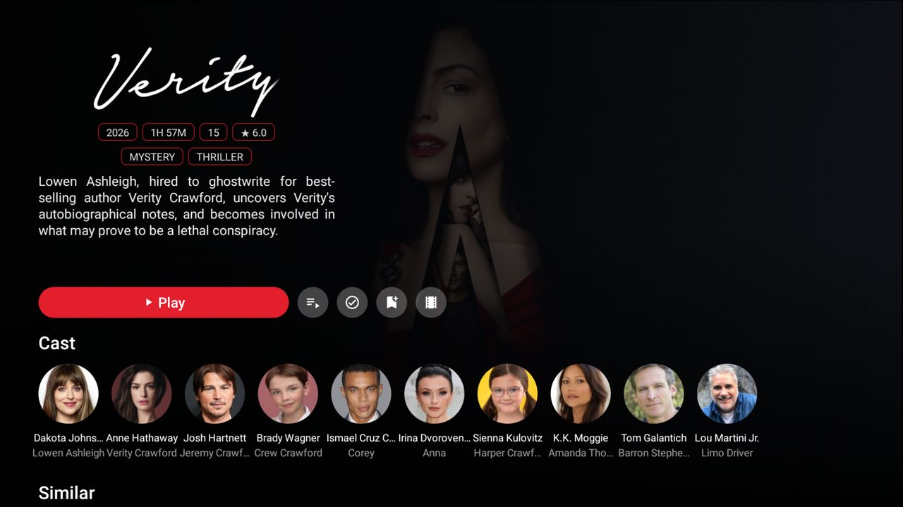
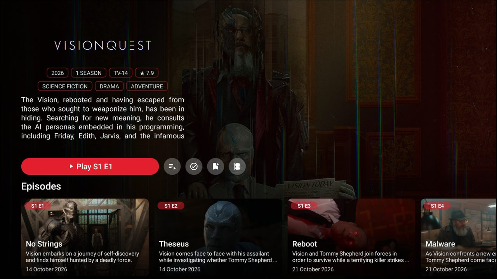
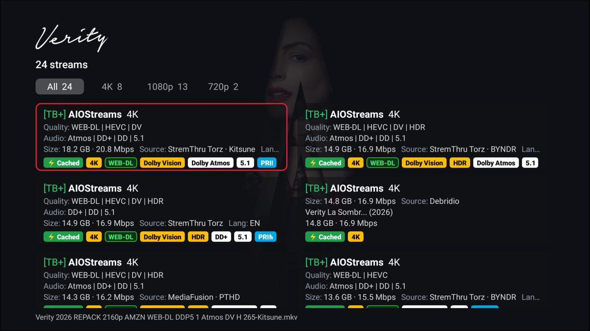
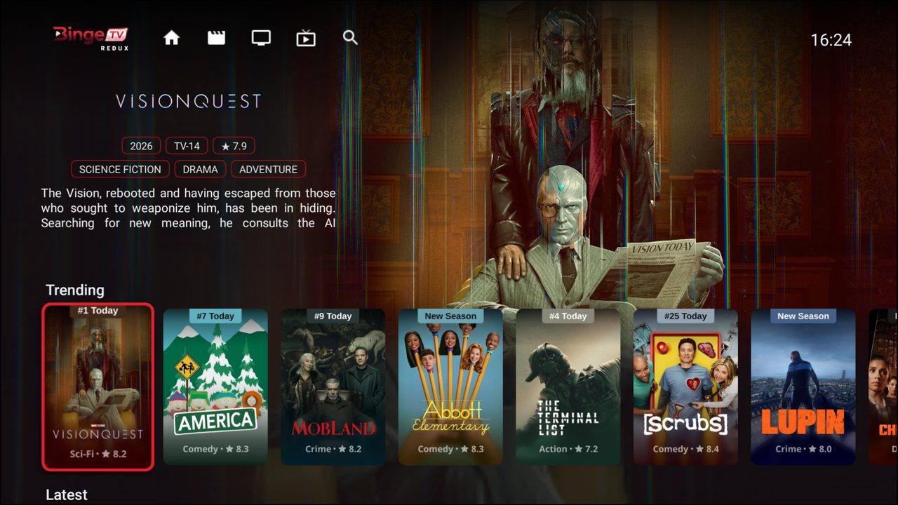
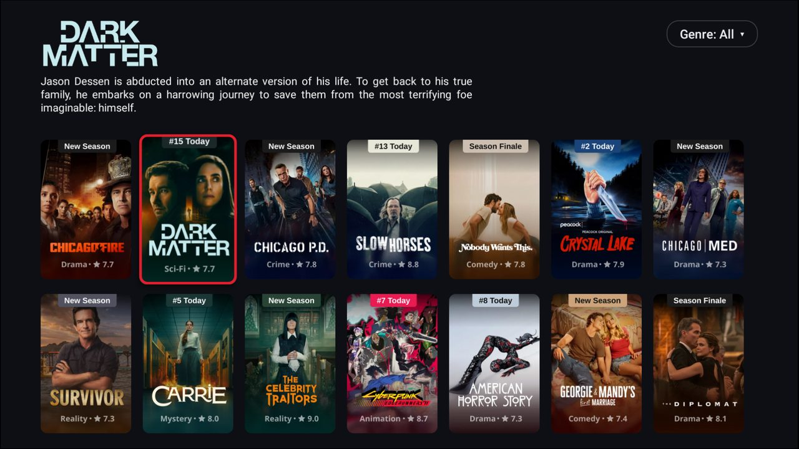
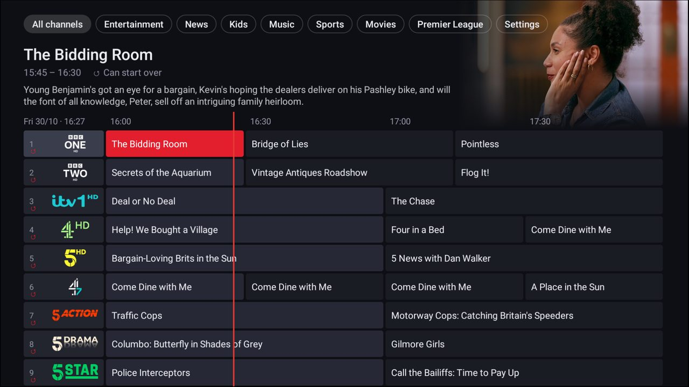

# BingeTV Redux



Films, series and live TV in one app for Fire TV and Android TV. Everything is set up from a web
page on your phone or computer, so there's no typing with the remote.

- **Films and series** from the Stremio addons you already use (AIOStreams, AIOMetadata,
  Cinemeta, Torrentio with debrid, OpenSubtitles and the rest): browse their catalogs, pick a
  stream and play.
- **Live TV** from Xtream Codes accounts, with a TV guide, catch-up and several streams per
  channel (this part was [FyrTuner](https://github.com/shiggsy365/FyrTuner)).
- **Radio and podcasts:** internet radio from the free radio-browser.info directory, and podcasts
  from their feeds, kept in step with your other podcast apps through an oPodSync (gPodder)
  server if you have one.

BingeTV Redux provides no content of its own. Everything comes from your own IPTV account, the
Stremio addons you add, and the public radio and podcast directories.

[](https://ko-fi.com/shiggsy365)

| | |
|---|---|
| <br>Home, with Continue Watching and the next episode | <br>Movies hub |
| <br>Film info page, with the cast | <br>Series info page, with its episodes |
| <br>Streams, with badges for quality, HDR and audio | <br>TV Shows hub |
| <br>A whole catalog, with a genre filter | <br>Live TV guide, with catch-up |

## Install

1. On the Fire TV or Android TV, allow apps from unknown sources (on a Fire TV, for the app you'll
   download with, such as Downloader).
2. Download an APK from the
   [latest release](https://github.com/shiggsy365/BingeTV-Redux/releases/latest) and install it:
   - `BingeTV-Redux-<version>-armeabi-v7a.apk`: Fire TV Sticks and most TVs (the smallest)
   - `BingeTV-Redux-<version>-arm64-v8a.apk`: 64-bit devices
   - `BingeTV-Redux-<version>.apk`: any of them
3. Open BingeTV Redux and select the **logo** at the left of its menu bar: profiles along the top,
   settings below. Scan the QR code with your phone, or open the address it shows on any device on
   the same network. The QR code fills in the PIN for you; otherwise type the 4-digit PIN shown on
   the TV.

About once a week the app checks for a new release and offers to install it. **Check for
updates** (under the logo) checks straight away.

## On the TV

- **Home and hubs:** each icon on the menu bar is a hub (Home, Movies, TV Shows and any you make)
  with a row for each of its catalogs. The focused title's logo, details and artwork fill the top
  of the screen, and ribbons and progress bars show what's paused or watched. Home can also have
  Continue Watching (including the next episode of shows you're watching), Next Up, your Watchlist
  and what's on live TV now.
- **See all:** a row's last card opens the whole catalog as a grid, with a genre filter.
- **Info pages:** details, seasons and episodes (with what you've watched), the cast (select
  someone to search for them), similar titles (with MDBList), Play or Resume, choose a stream,
  mark watched (with undo), the watchlist and the trailer.
- **Streams:** cards in two columns with badges for quality, HDR, audio and cached, filtered by
  resolution. Streams appear as each addon answers.
- **Player:** the OSD has the title, times, progress (Up to seek, Left/Right to skip) and buttons
  for streams, audio, subtitles (tracks from the video or your subtitle addons, an offset to fix
  lip sync, and a style), picture size and speed. If a stream fails, the next one is tried. Near
  the end of an episode, Up Next counts down to the next one (from the start of the credits,
  where they're known). While an intro, recap or credits play, a "Skip intro" chip skips them
  (times from IntroDB, and AniSkip for anime); episodes also have a "Skip 85 s" button. Before
  playback starts, the TV
  switches to the refresh rate that suits the video (50 Hz for UK television) where it has one,
  so there's no flash once it's playing.
- **Search** across all your search catalogs, podcasts and radio stations as you type, with your
  recent searches and IMDb's suggestions as chips under the box.
- **Radio:** favourite stations, the most popular in your country and worldwide, and genres.
  Stations keep playing while you browse (back to them from ♪ on the menu bar), and the remote's
  play/pause works on any screen.
- **Podcasts:** Continue listening, the latest episodes of your podcasts, your subscriptions and
  Apple's top podcasts. Each podcast's page has Subscribe and its episodes; episodes carry on
  where you left them.
- **Live TV:** the guide by channel group, with the same OSD, plus channels, catch-up, Start over
  and Change stream. A stream whose Xtream account is already in use on another TV is skipped, so
  nobody gets cut off.

## Setting up (on the web page)

- **Each profile has its own addons and catalogs**, picked at the top of the Addons and Catalogs
  pages. A new profile starts with a copy of the one in use on the TV.
- **Addons:** paste each addon's manifest URL (or `stremio://` link). Addons are asked in the
  order listed, so put your best metadata addon (e.g. AIOMetadata) above Cinemeta. Configure,
  refresh, reorder, turn off or remove them here. Torrent-only streams aren't played: use a
  debrid service through your addon.
- **Catalogs:** each hub is a page on the TV's menu bar, with a row for each catalog in it. Move
  catalogs between hubs, rename, reorder or hide them, and choose which ones Search uses.
- **Profiles:** each person gets their own picture, watch history, settings and MDBList account.
  Per profile: stream order and filters (highest resolution, file size, hide CAM, keywords),
  whether Play starts the best stream or lists them, Up Next, audio and subtitle languages (best
  first), Home's rows, trailers on Home, live TV on or off, and MDBList.
- **Live TV** (groups and channels, logos, guides): Xtream accounts, channel groups, merging and
  order, logos, XMLTV guides and catch-up.
- **Radio and Podcasts:** turn them on or off, find stations to add to favourites, subscribe to
  podcasts (by search or feed URL), and set a gPodder-compatible sync server (oPodSync,
  Nextcloud gPodder Sync) and an optional Podcast Index key.
- **Backup and restore:** a backup holds everything, including every profile with its history,
  favourite stations, podcasts and recent searches, and live TV. A FyrTuner backup restores its live TV settings.

**The web page is local to your home network.** It's served by the app on the TV itself, not from
a website, so it only opens on devices connected to the same network as the TV. What you enter
there (addon links, Xtream logins, your MDBList key) is saved on the TV and isn't sent to us or
any other server. The app only uses those details to contact the services they belong to.

The page also only works in a browser that has entered the TV's PIN. Settings on the TV can make a
new PIN or forget every browser.

## Building

```
./gradlew assembleDebug
```

Release builds (`./gradlew assembleRelease`) make one APK per ABI plus a universal one. They are
signed with the key named in `keystore.properties` (`storeFile`, `keyAlias`, `storePassword`),
which is never committed. GitHub Actions signs them with the `REDUX_KEYSTORE` (base64 of the
keystore) and `REDUX_KEY_PASSWORD` secrets, or with the debug key without them.

Unit tests: `./gradlew testDebugUnitTest`. `tools/make_branding.py` regenerates the icons, banner
and logos from `branding/`.

## Licence

BingeTV Redux is released under the [GNU General Public License v3.0](LICENSE), as it includes
FFmpeg audio decoders from nextlib, which is GPL-3.0.

The live TV side started from Amazon's
[Fire TV Live TV sample app](https://github.com/amzn/ftv-livetv-sample-tv-app). The code that came
from it keeps its Apache 2.0 licence and notices (see [LICENSE-APACHE-2.0](LICENSE-APACHE-2.0) and
[NOTICE](NOTICE)).

## Credits

Playback uses Media3 ExoPlayer with FFmpeg audio decoders from
[nextlib](https://github.com/anilbeesetti/nextlib). Images load with Glide, the web page is served
by NanoHTTPD and QR codes come from ZXing.

**Support the ecosystem:**

[](https://ko-fi.com/shiggsy365)
